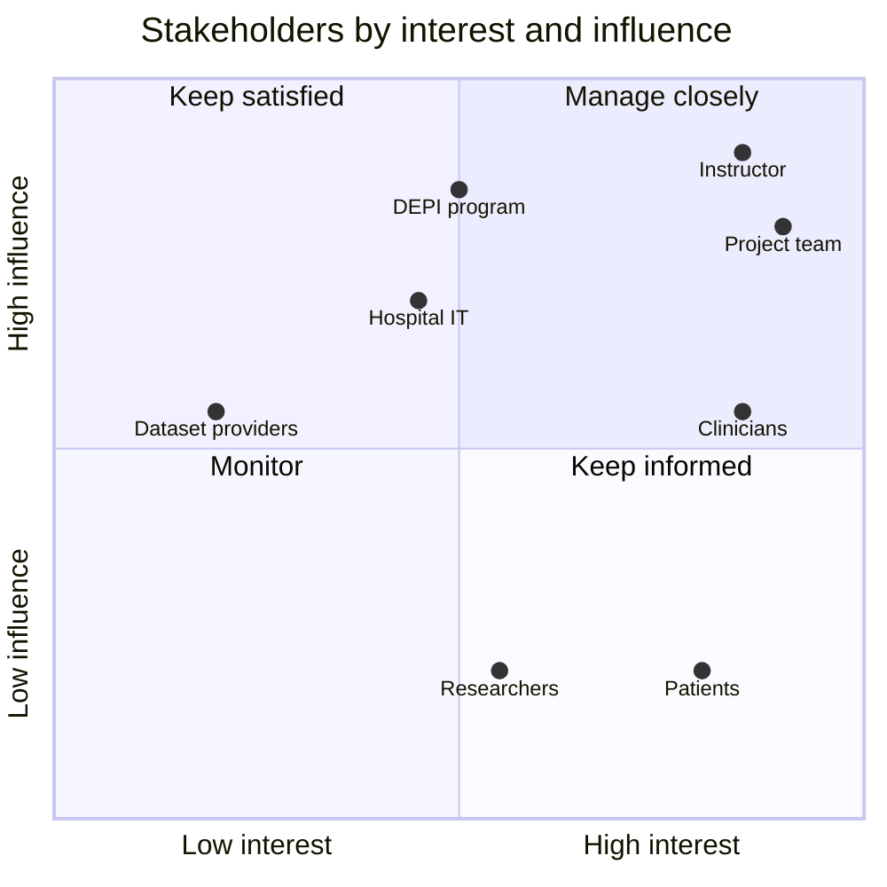
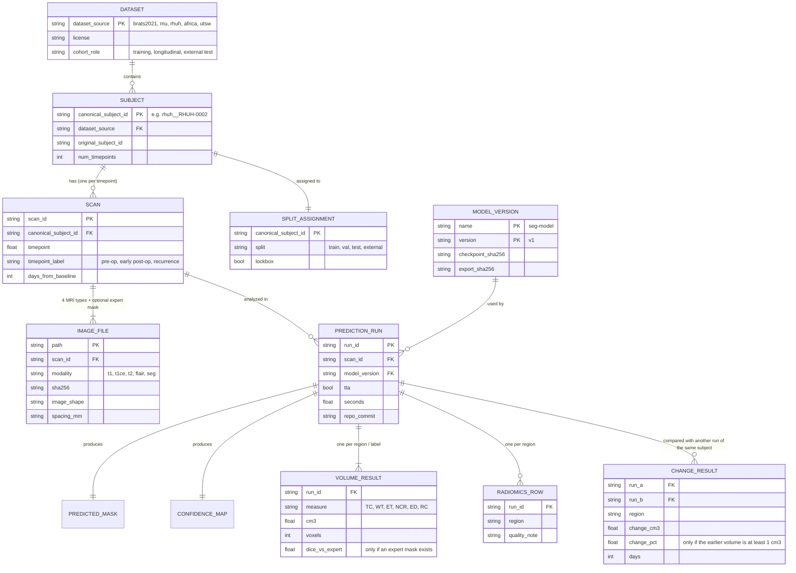
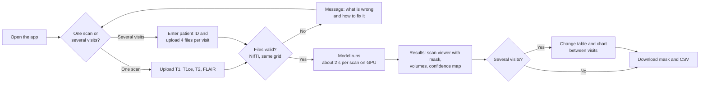

# Project Documentation

**AI-Powered Brain MRI Tumor Analysis, Segmentation, and Quantitative Assessment System**

DEPI (Digital Egypt Pioneers Initiative), AI & Data Science track, Machine Learning, 2026.
Instructor: Eng. Aya Abdallah.
Team: Mohamed Tagy, Alaa Emad, Hagar Aiman, Yasmin Mahmoud, Maryam Ahmed, Essam Mohamed.
Source code: https://github.com/nhahub/NHA-5-187. Status on 31 Oct 2026.

> **Decision-support research prototype only.** The system is not a medical device, it does not diagnose anyone, and it
> has not been validated for clinical use. Every screen, report and slide must say so.

Contents:
1. [Project planning](#1-project-planning)
2. [Stakeholder analysis](#2-stakeholder-analysis)
3. [Database and data design](#3-database-and-data-design)
4. [UI/UX design](#4-uiux-design)

---

## 1. Project planning

### 1.1 Goal and scope

The system takes the four MRI types of a brain scan (T1, T1ce, T2, FLAIR). It finds the glioma in 3D and reports
three nested tumor regions: whole tumor (WT), tumor core (TC) and enhancing tumor (ET). For each scan it gives:

- the tumor volume per region;
- the change between two scans of the same patient;
- radiomics features;
- a confidence (uncertainty) map that shows where the model is unsure.

All of this is served through an API and a web interface.

| In scope | Out of scope |
| --- | --- |
| Gliomas in skull-stripped, co-registered multi-sequence MRI (BraTS format) | Other tumor types, raw DICOM from scanners, diagnosis or treatment advice |
| Training on BraTS 2021; external testing on other public cohorts | Collecting new patient data; any private or identifiable data |
| A prototype web app for demonstration | A certified clinical product |

### 1.2 Approach

| Phase | Method |
| --- | --- |
| Data | BraTS 2021 (1,251 patients) for training. The patients are split 875 / 188 / 188 (train / validation / locked test), with a fixed seed. External tests use BraTS-Africa and UTSW-Glioma. Change over time uses MU-Glioma-Post and RHUH-GBM. Every file is checksummed (SHA-256). |
| Model | A 3D U-Net baseline (mean Dice 0.765) against nnU-Net 3d_fullres (mean Dice 0.908 on the 188 validation patients). nnU-Net was selected and registered as **seg-model v1**. |
| Analysis | Volumes per region and per label; change between scans; radiomics (PyRadiomics); confidence maps from nnU-Net's 8 mirror flips. All of these run in one command. |
| Deployment | The model is exported to TorchScript: 2.1 s per scan on a T4 GPU, or exactly the v1 mask in 8.6 s. Then a FastAPI backend, a web interface, Docker, and Azure. |
| Validation | A final test on the locked test patients and the external cohorts, run once, at the end. |

### 1.3 Milestones

The project ran for six weeks. The milestones overlap so that the team could work in parallel. Tasks are tracked on the
team's Notion board: 30 tasks, each with an owner, a start date, a deadline (11:59 pm Cairo time), a "done when"
condition and the tasks it depends on.

| Milestone | Dates (2026) | Main outputs | Status on 31 Oct |
| --- | --- | --- | --- |
| M1 – Data foundation | 23 Sep – 4 Oct | Datasets, checksums, cleaned scans, patient split with a locked test set, data loader, [EDA report](EDA_REPORT.md) | Done |
| M2 – Segmentation model | 26 Sep – 9 Oct | Experiment tracking, metrics, 3D U-Net baseline, nnU-Net, slice viewer, registered model with [model card](../models/registry/seg-model/v1/model_card.md) | Done |
| M3 – Quantitative analysis | 10 – 18 Oct | Volumes, change over time, radiomics, confidence maps, one [analysis pipeline](PIPELINE.md) | Done |
| M4 – Application and deployment | 17 – 28 Oct | [Fast model](DEPLOY_MODEL.md), FastAPI backend, web interface, Docker, Azure, app test | In progress: model and backend done; web interface in progress; Docker, Azure and the app test not started |
| M5 – Final validation and delivery | 15 – 31 Oct | Final test plan and run, final report, presentation and demo, reproducibility package | Not started |

### 1.4 Tasks

| ID | Task | Owner | Start → deadline | Status |
| --- | --- | --- | --- | --- |
| M1-T01 | Choose the datasets and get access | Alaa Emad | 23 → 24 Sep | Done |
| M1-T02 | Prepare the repo, environment and CI | Maryam Ahmed | 23 → 25 Sep | Done |
| M1-T03 | Download the data and list every patient | Hagar Aiman | 24 → 24 Sep | Done |
| M1-T04 | Clean the scans and split the patients | Yasmin Mahmoud | 25 → 25 Sep | Done |
| M1-T05 | Build the data loader | Mohamed Tagy | 26 → 27 Sep | Done |
| M1-T06 | Milestone 1 review | Essam Mohamed | 30 Sep → 4 Oct | Done |
| M2-T01 | Set up experiment tracking (MLflow) | Maryam Ahmed | 26 Sep → 3 Oct | Done |
| M2-T02 | Write the evaluation metrics | Yasmin Mahmoud | 26 Sep → 3 Oct | Done |
| M2-T03 | Train the 3D U-Net baseline | Mohamed Tagy | 28 Sep → 3 Oct | Done |
| M2-T04 | Train nnU-Net and compare the models | Alaa Emad | 4 → 8 Oct | Done |
| M2-T05 | Build a simple slice viewer | Essam Mohamed | 26 Sep → 3 Oct | Done |
| M2-T06 | Milestone 2 review: save the chosen model | Hagar Aiman | 9 → 9 Oct | Done |
| M3-T01 | Measure tumor volume per region | Hagar Aiman | 10 → 11 Oct | Done |
| M3-T02 | Compare two scans of the same patient over time | Alaa Emad | 12 → 14 Oct | Done |
| M3-T03 | Extract radiomics features | Yasmin Mahmoud | 10 → 14 Oct | Done |
| M3-T04 | Add a confidence (uncertainty) map | Mohamed Tagy | 10 → 14 Oct | Done |
| M3-T05 | Combine everything into one analysis pipeline | Maryam Ahmed | 15 → 16 Oct | Done |
| M3-T06 | Milestone 3 review | Essam Mohamed | 17 → 18 Oct | Done |
| M4-T01 | Package the model for fast prediction | Mohamed Tagy | 17 → 18 Oct | Done |
| M4-T02 | Build the FastAPI backend | Maryam Ahmed | 19 → 20 Oct | Done |
| M4-T03 | Build the web interface | Essam Mohamed | 21 → 26 Oct | In progress |
| M4-T04 | Put everything in Docker | Alaa Emad | 21 → 23 Oct | Not started |
| M4-T05 | Deploy to Azure | Yasmin Mahmoud | 24 → 26 Oct | Not started |
| M4-T06 | Milestone 4 review: test the full app | Hagar Aiman | 27 → 28 Oct | Not started |
| M5-T01 | Freeze the final test plan | Yasmin Mahmoud | 15 → 16 Oct | Not started |
| M5-T02 | Run the final tests | Maryam Ahmed | 21 → 28 Oct | Not started |
| M5-T03 | Write the final report | Hagar Aiman | 29 → 30 Oct | Not started |
| M5-T04 | Prepare the presentation and demo | Essam Mohamed | 29 → 30 Oct | Not started |
| M5-T05 | Package the code so results can be repeated | Alaa Emad | 29 → 30 Oct | Not started |
| M5-T06 | Milestone 5 review and submission | Mohamed Tagy | 31 → 31 Oct | Not started |

Several M4 and M5 tasks are past their deadlines. The new dates have not been set yet.

### 1.5 Team roles

| Member | Main role |
| --- | --- |
| Mohamed Tagy | Model development and evaluation lead (M2); data loader, baseline training, confidence maps, fast model; repository maintainer (reviews and merges pull requests) |
| Alaa Emad | Data engineering lead (M1); dataset access, nnU-Net training, change over time, Docker |
| Hagar Aiman | Quantitative analysis lead (M3); data download, model registration, tumor volumes, app testing, final report |
| Yasmin Mahmoud | Scan cleaning and split, metrics, radiomics, Azure deployment, final test plan |
| Maryam Ahmed | Repository and experiment tracking, analysis pipeline, FastAPI backend, final test run |
| Essam Mohamed | Viewer and web interface, milestone reviews, presentation and demo (M5 lead) |

### 1.6 How the team works

- **Code:** a public GitHub repository. The initiative does not allow adding collaborators, so members fork the
  repository and open pull requests. Each branch is named after its task ID, and Mohamed reviews and merges.
  Automated tests run with `pytest`.
- **Compute and data:** Google Colab (free T4 GPU) and the team's shared Google Drive folder `BrainMRI_Data`. No data,
  weights or credentials are kept in the repository.
- **Tracking:** the Notion task board (status, owner, "completed by", dependencies) and a milestone review task at the
  end of each milestone. Experiments are tracked with MLflow.

### 1.7 Risks and how they were handled

| Risk | Handling |
| --- | --- |
| Test patients leak into training or tuning | The test patients and external cohorts are locked. The code refuses to load them before the final evaluation (`bmts.data.splits`). |
| Public "external" datasets overlap with BraTS 2021 | Overlap was checked before choosing the cohorts. UPenn-GBM, UCSF-PDGM and TCGA were rejected because they are part of BraTS 2021 ([dataset research](dataset_research.md)). |
| Limited GPU (free Colab, 4 GB laptop GPU) | Training ran in Colab, restarting where it stopped. nnU-Net was trained for 50 epochs. The cleaned data is stored as tar archives, which load faster. |
| Unsupported clinical claims | A decision-support notice on every output, document and screen. A [model card](../models/registry/seg-model/v1/model_card.md) states the limits. |
| Schedule pressure (about 208 person-days of work against 180 available) | Effort estimates per task, helpers assigned to large tasks, and tasks running in parallel where their dependencies allow. |

---

## 2. Stakeholder analysis

### 2.1 Stakeholders

| Stakeholder | Role | Interest in the project | Influence | What they need from the system |
| --- | --- | --- | --- | --- |
| DEPI instructor (Eng. Aya Abdallah) | Supervises and grades the project | High | High | Clear milestones, EDA and visualizations, a working demo, honest results, documentation |
| DEPI program | Runs the initiative and sets submission rules | Medium | High | Deliverables on time in the required form |
| Project team (6 members) | Build and present the system | High | High | Clear tasks and owners, shared data and compute, reproducible code |
| Radiologists and neuro-oncologists (intended users) | Would read the outputs in a real setting | High | Medium | Accurate tumor outlines, volumes, change between scans, a clear sign of where the model is unsure, fast results |
| Patients (indirectly affected) | Their scans are what the system analyzes | High | Low | Privacy, no misuse of results, no automated diagnosis |
| Hospital IT and data-protection officers (future) | Would run the system on their network | Medium | High | No storage of personal data, secure deployment, clear limits |
| Dataset providers (BraTS, TCIA cohorts) | Own the data and its licenses | Low | Medium | License terms respected, citations, no redistribution of the data |
| Researchers and students | Could reuse the code and results | Medium | Low | Open code, documented methods, results that can be repeated |

### 2.2 Interest and influence



- **Manage closely** (the instructor and the team): weekly progress on the task board, milestone reviews, and quick
  action on feedback. For example, the EDA report and charts were added after the instructor's comment.
- **Keep satisfied** (the DEPI program, hospital IT): follow the submission rules, store no personal data, and document
  the deployment.
- **Keep informed** (clinicians, patients): the decision-support notice, the model card with its limits, the confidence
  map, and readable volume and change reports.
- **Monitor** (dataset providers, researchers): a license register in the [dataset research](dataset_research.md),
  citations, and open code with tests.

### 2.3 Requirements derived from the stakeholders

| Requirement | From | Where it is met |
| --- | --- | --- |
| Segment WT, TC and ET in 3D with validated accuracy | Clinicians, instructor | seg-model v1: Dice 0.917 / 0.935 / 0.872 on 188 validation patients ([nnU-Net training](TRAINING_NNUNET.md)) |
| Report tumor volumes and change between scans | Clinicians | [M3-T01](../results/M3-T01/README.md), [M3-T02](../results/M3-T02/README.md), the [analysis pipeline](PIPELINE.md) |
| Show where the model may be wrong | Clinicians | [Confidence maps](UNCERTAINTY.md) |
| Result within seconds | Clinicians | 2.1 s per scan on a T4 GPU ([deployment](DEPLOY_MODEL.md)) |
| Never present results as a diagnosis | Patients, clinicians, instructor | Notice in the API, the pipeline outputs, the viewer and every document |
| No personal data stored or published | Patients, hospital IT, dataset providers | Only public, de-identified datasets; no data in the repository; uploads processed in a per-run folder |
| Fair, honest evaluation | Instructor, researchers | Locked test set, external cohorts, final test run once (M5) |
| Reproducible results | Instructor, researchers | Pinned versions, checksums, registered model with SHA-256, tests, Colab notebooks |

---

## 3. Database and data design

### 3.1 Storage choice

The system does **not use a database server**. Every piece of data is either a medical image file or a small table,
and both are kept as files:

- **MRI scans and masks** are 3D NIfTI files (`.nii.gz`), several megabytes each. Imaging tools read them directly. A
  database would only store their paths.
- **Tables** (patient lists, checksums, the split, results) are CSV and JSON files. They are small, versioned in git
  or on Drive, and easy to read in Colab.
- **Experiments** are tracked by MLflow in its own SQLite file on Drive (`BrainMRI_Data/mlflow.db`).
- The API is stateless. Each request writes its outputs to a new run folder; no patient record is kept between requests.

The logical model below is what a database would contain if the system moved to a hospital setting. Each entity
already has a file that holds it, listed in section 3.3.

### 3.2 Logical data model



### 3.3 Where each entity is stored

| Entity | File | Location | Key columns |
| --- | --- | --- | --- |
| Dataset, subject, scan | `unified_subject_index.csv` | `data/manifests/` (repo) | `canonical_subject_id`, `dataset_source`, `timepoint_index`, `timepoint_label`, `days_from_baseline`, availability of each MRI type, `license`, `qc_status` (64 columns) |
| Image file | `<cohort>_manifest.csv` (one per dataset) | `data/manifests/` (repo) | `cohort`, `subject_id`, `scan`, `file_name`, `size_bytes`, `sha256`, `md5`, `image_shape`, `spacing_mm`, `label_values` |
| Split assignment | `split_v1.csv` | `BrainMRI_Data/qc/` (Drive) | `dataset_source`, `canonical_subject_id`, `split`, `lockbox`. One row per patient for BraTS; one row per scan for the longitudinal cohorts |
| Model version | `manifest.json`, `model_card.md`, `nnunet/plans.json` | `models/registry/seg-model/v1/` (repo); weights on Drive | `checkpoint_file.sha256`, `nnunet.configuration`, validation metrics |
| Exported model | `deploy_manifest.json` | `BrainMRI_Data/models/seg-model-v1-torchscript/` (Drive) | `model_sha256`, `source.checkpoint_sha256`, `patch_size`, `mirror_axes`, versions |
| Prediction run | `run_summary.json` | output folder of each analysis run | scans, model, settings, repo commit, run time |
| Predicted mask, confidence map | `<scan>_seg.nii.gz`, `<scan>_uncertainty.nii.gz`, `<scan>_disagreement.nii.gz` | output folder | same grid as the input scan |
| Volume result | `volumes.csv`, `metrics.csv` | output folder | `scan_id`, `<measure>_cm3`, `<measure>_voxels`, `dice_<region>` |
| Change result | `changes.csv` | output folder | `tp_a`, `tp_b`, `pair`, `region`, `vol_a_cm3`, `vol_b_cm3`, `change_cm3`, `change_pct`, `pct_note`, `days`, `source` |
| Radiomics row | `radiomics.csv` | output folder | `patient_id`, `region`, `voxels`, `shape_*`, `<mri type>_<feature class>_<feature>`, `quality_note` |
| Experiment | MLflow tables | `BrainMRI_Data/mlflow.db` (Drive) | run ID, parameters, metrics per epoch |

### 3.4 File layout on the shared Drive

```
BrainMRI_Data/
├── raw/<cohort>/                 original downloads, one .tar per dataset (never edited)
├── processed/brats2021_trainval_v1.tar
│                                 cleaned BraTS 2021 train + validation scans
├── qc/split_v1.csv               patient split; test and external rows are locked
├── manifests/                    patient lists and checksums (copied into the repo)
├── models/seg-model-v1-torchscript/
│                                 exported model for the app
├── runs/<task>/                  results of each task run (training, M3 analyses, M4 checks, API runs)
└── mlflow.db                     experiment tracking
```

Cleaned scans follow one layout everywhere (scan cleaning, loader, viewer, pipeline, API):
`<root>/<dataset>/<subject>/<timepoint>/{t1, t1ce, t2, flair, seg}.nii.gz`. Every scan is RAS-oriented, padded to
240 × 240 × 155 at 1 mm and z-scored inside the brain.

### 3.5 Label scheme

| Value | Label | Part of region |
| --- | --- | --- |
| 0 | Background | – |
| 1 | NCR (necrotic / non-enhancing core) | TC, WT |
| 2 | ED (edema) | WT |
| 3 | ET (enhancing tumor) | TC, WT, ET |
| 4 | RC (resection cavity, post-surgery scans only) | none; never counted as tumor |

BraTS 2021 stores ET as label 4. The cleaning step maps it to 3, so every dataset uses the scheme above.

### 3.6 API data contract (FastAPI backend, M4-T02)

| Endpoint | Input | Output (JSON) |
| --- | --- | --- |
| `GET /health` | – | Service status, model export present, device, settings, accepted file types, required MRI types |
| `POST /predict` | Form upload: `t1`, `t1ce`, `t2`, `flair` (`.nii`/`.nii.gz`), `case_id`, `run_radiomics` | `input_validation` (shape, voxel spacing, geometry check), `segmentation` (mask path, volumes per region), `inference_timings`, `radiomics` status |
| `POST /predict/longitudinal` | `patient_id`, `visits_json` (visit IDs and file names), 4 files per visit | The result of each visit, plus `longitudinal_changes`: from/to visit, region, volumes before and after, change in cm³ and % |

Wrong file types are refused with HTTP 415. Mismatched geometry between the four MRI types is refused before the model
runs.

### 3.7 Data rules

- Only public, de-identified datasets are used, under their licenses. No dataset is redistributed.
- The repository holds no MRI data, no model weights and no credentials.
- Test and external patients are locked. `bmts.data.splits` refuses them, and only the final evaluation may read them.
- Every file is checksummed, and the model is checked by SHA-256 before every use.
- The API keeps no patient record. Each request gets its own run folder.

---

## 4. UI/UX design

### 4.1 Users and their goals

| User | Goal | What the interface must do |
| --- | --- | --- |
| Radiologist / oncologist (main user) | See the tumor, its size, and how it changed since the last scan | Show the scan with the mask on top, volume per region, change between visits, where the model is unsure |
| Researcher | Check the model's output against expert masks | Show Dice when an expert mask is available; export CSV results |
| Instructor / demo audience | Understand what the system does in a few minutes | A clear flow from upload to result, with plain labels |

### 4.2 Design principles

1. **Decision support, not diagnosis.** A visible notice on every screen and in every exported result.
2. **The image comes first.** The scan and the mask take most of the screen; the numbers sit beside them.
3. **Show uncertainty.** The confidence map is one click away, so a doctor knows where to check the mask.
4. **Plain words.** Region names are spelled out ("Enhancing tumor (ET)"), and volumes are given in cm³.
5. **Same colors everywhere.** NCR orange `#eb6834`, edema green `#1baf7a`, enhancing tumor pink `#e87ba4`, uncertainty
   yellow to red. The colors are also told apart by legend and text, not by color alone.
6. **Refuse early.** Wrong file types or mismatched scans get a clear message before any computing starts.

### 4.3 User flow



### 4.4 Screens

**Implemented: the slice viewer (M2-T05, `apps/m2_t05_viewer.py`, Streamlit).** It shows one cleaned scan with the
mask on top:
- a sidebar with the data folder, the mask opacity (0.10–0.80) and a show/hide switch for the mask;
- a patient/timepoint list, an MRI type selector (FLAIR by default) and an axial slice slider;
- a legend naming the labels visible on the slice, and the decision-support caption under the title.

**Web interface (M4-T03, in progress by Essam Mohamed).** It is built on the FastAPI backend and follows the flow
above. The layouts below are the design reference for its four screens.

Screen 1: upload
```
┌──────────────────────────────────────────────────────────────────────┐
│ Brain MRI Tumor Analysis        Research prototype – not a diagnosis │
├──────────────────────────────────────────────────────────────────────┤
│  ( ) One scan     ( ) Several visits of one patient                  │
│                                                                      │
│  Case / patient ID  [______________]                                 │
│  T1    [ Choose .nii.gz ]  ✓ t1.nii.gz                               │
│  T1ce  [ Choose .nii.gz ]  ✓ t1ce.nii.gz                             │
│  T2    [ Choose .nii.gz ]  ✓ t2.nii.gz                               │
│  FLAIR [ Choose .nii.gz ]  ✓ flair.nii.gz                            │
│  [x] Radiomics features (slower)                                     │
│                                                    [ Analyze scan ]  │
└──────────────────────────────────────────────────────────────────────┘
```

Screen 2: result for one scan
```
┌───────────────────────────────────────────┬──────────────────────────┐
│  MRI type: [FLAIR v]   View: [Axial v]    │ Tumor volumes            │
│                                           │  Whole tumor (WT) 84.2cm³│
│        ┌─────────────────────────┐        │  Tumor core (TC)  31.0cm³│
│        │   scan slice with       │        │  Enhancing (ET)   12.4cm³│
│        │   colored mask overlay  │        │  Edema 53.2 · NCR 18.6   │
│        └─────────────────────────┘        ├──────────────────────────┤
│  Slice  [=========|==========] 77 / 155   │ Model confidence         │
│  Opacity [=====|=====]  [ ] Confidence map│  Uncertain volume 1.3 cm³│
│  ■ NCR  ■ Edema  ■ Enhancing tumor        │ Time: 2.1 s              │
├───────────────────────────────────────────┴──────────────────────────┤
│ [ Download mask (.nii.gz) ]  [ Download results (.csv) ]             │
│ Decision-support research prototype. Not a medical diagnosis.        │
└──────────────────────────────────────────────────────────────────────┘
```

Screen 3: change between visits
```
┌──────────────────────────────────────────────────────────────────────┐
│ Patient P-001 – 3 visits                                             │
│  Visit:  [ pre-op ]  [ early post-op ]  [ recurrence ]  (side by side)│
├──────────────────────────────────────────────────────────────────────┤
│  Region  pre-op → post-op       post-op → recurrence                 │
│  WT      -71.5 cm³ (-85 %)      +40.2 cm³ (+320 %)                    │
│  TC      ...                    ... (% not given: earlier < 1 cm³)    │
│  [ line chart: volume per region over the visits ]                   │
└──────────────────────────────────────────────────────────────────────┘
```

Screen 4: about and limits. This screen covers intended use (research and decision support), the training data,
validation scores, known limits (cleaned BraTS-style scans only; early post-surgery scans are harder), and the
requirement for expert review. It links to the [model card](../models/registry/seg-model/v1/model_card.md).

The numbers in these layouts are placeholders that show the format. They are not results.

### 4.5 Usability checks for the app test (M4-T06)

- A first-time user completes an analysis of a demo case without help.
- Every error message says what went wrong and what to do next.
- Results, volumes and the decision-support notice are readable at 1366 × 768 and on a projector.
- Region colors are explained by a legend; information is never given by color alone.
- The demo uses only validation or longitudinal cases, never locked test patients.
